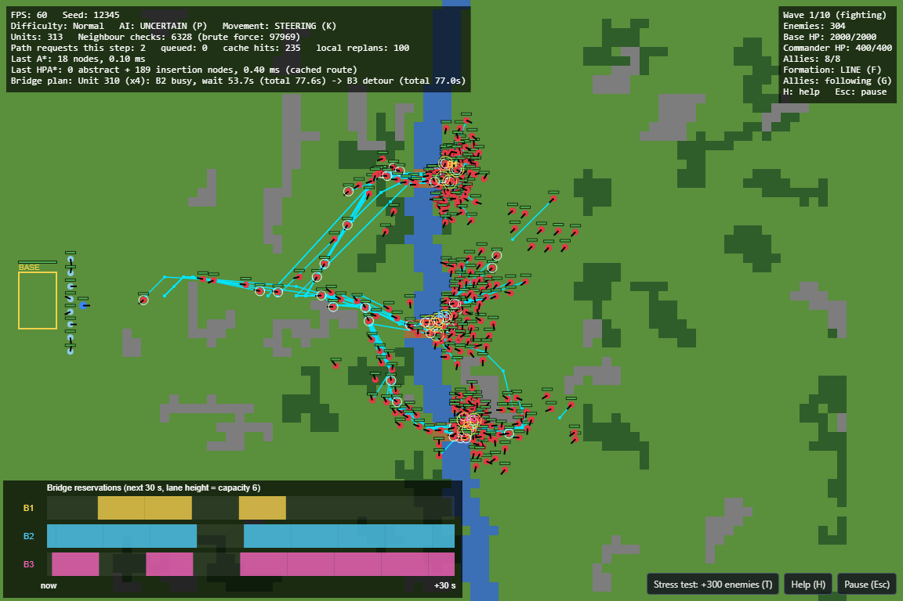

# Siege of the Grid

A top-down 2D real-time defense game that runs in the browser, built for the
**AI in Gaming** course (Unit 3: NPC movement, kinematic vs steering movement,
pathfinding, hierarchical and time-aware pathfinding, decision making, and the
complexity fallacy). Every concept from the unit is a **visible, toggleable
mechanic**, so it can be demonstrated live.

Defend your base on the left of the map against 10 waves of enemy squads that
cross a river by one of three bridges. You control the Commander. Eight allied
soldiers follow you in formation or guard the base.



**Live version:** https://advikaaaa.github.io/siege-of-the-grid/

Plain HTML5 Canvas and vanilla JavaScript ES modules. No frameworks, no game
engine, no build step, no runtime dependencies.

## Controls

| Key / input | Action |
|---|---|
| Left click | Move the Commander (A* + path smoothing + path following) |
| F | Ally formation: Line / V / Box |
| G | Allies guard the base / rejoin the Commander |
| K | Switch ALL units between kinematic and steering movement |
| P | Enemy AI: uncertain (weighted dice) / predictable rules |
| T or toolbar button | Stress test: spawn 300 extra marching enemies |
| 1 | Overlay: paths (raw A* orange, smoothed waypoints cyan, local replans magenta) |
| 2 | Overlay: HPA* clusters, entrances and abstract route |
| 3 | Overlay: steering vectors (velocity and each force) and feelers |
| 4 | Overlay: FSM state above every NPC |
| 5 | Overlay: bridge reservation timeline, units waiting for their slot |
| 6 | Overlay: sight radii |
| 7 | Overlay: spatial hash cells |
| H | Help overlay with every key |
| Esc | Pause menu |

The main menu has Play, **AI Lab** (behavior playground, A* vs HPA* comparison,
pathfinding benchmark), **How It Works** (every concept explained in the game)
and the difficulty selector. Enemies get smarter, not stronger.

## Concept -> file

| Course concept | Main file(s) |
|---|---|
| Kinematic movement | [src/movement/kinematic.js](src/movement/kinematic.js), [src/movement/agent.js](src/movement/agent.js) |
| Steering behaviors and blending | [src/movement/steering.js](src/movement/steering.js), [src/movement/unitMovement.js](src/movement/unitMovement.js) |
| Formations | [src/movement/formations.js](src/movement/formations.js), [src/ai/formationKeeping.js](src/ai/formationKeeping.js) |
| A* and the binary heap | [src/pathfinding/astar.js](src/pathfinding/astar.js), [src/pathfinding/priorityQueue.js](src/pathfinding/priorityQueue.js) |
| Path smoothing | [src/pathfinding/smoothing.js](src/pathfinding/smoothing.js) |
| Hierarchical pathfinding (HPA*) | [src/pathfinding/hpa.js](src/pathfinding/hpa.js) |
| Time-aware planning at chokepoints | [src/pathfinding/reservations.js](src/pathfinding/reservations.js), [src/pathfinding/pathService.js](src/pathfinding/pathService.js) |
| Local replanning | [src/game/gameWorld.js](src/game/gameWorld.js) (`updateLocalReplanning`) |
| Many NPCs: spatial hash, time slicing, caching | [src/core/spatialHash.js](src/core/spatialHash.js), [src/pathfinding/pathService.js](src/pathfinding/pathService.js) |
| Finite state machines | [src/ai/fsm.js](src/ai/fsm.js), [src/ai/enemyBrain.js](src/ai/enemyBrain.js), [src/ai/allyBrain.js](src/ai/allyBrain.js) |
| Uncertainty and the complexity fallacy | [src/ai/decision.js](src/ai/decision.js) |
| Difficulty scaling | [src/ai/difficulty.js](src/ai/difficulty.js) |
| Seeded randomness | [src/core/rng.js](src/core/rng.js) |
| Fixed-timestep game loop | [src/core/loop.js](src/core/loop.js) |

Full explanations: [docs/CONCEPTS.md](docs/CONCEPTS.md). How the code fits
together: [docs/ARCHITECTURE.md](docs/ARCHITECTURE.md). Study order:
[docs/CODE_WALKTHROUGH.md](docs/CODE_WALKTHROUGH.md). Viva practice:
[docs/VIVA_QA.md](docs/VIVA_QA.md).

## Run locally

Browsers refuse to load ES modules from `file://`, so serve the folder over HTTP:

```
python -m http.server 8000
```

or, with Node installed:

```
npx serve .
```

Then open http://localhost:8000 (or the address `npx serve` prints). Add
`?seed=4242` to the URL to play a specific map; the same seed always gives the
same map and the same enemy decisions.

If the page looks wrong after you change a file, press Ctrl+F5: browsers cache
the old CSS and JavaScript.

## Run the tests

The tests use only Node's built-in test runner (Node 22 or newer):

```
npm test
```

70 tests cover the priority queue, A* optimality (against plain Dijkstra on random
grids), unreachable goals and corner-cutting, HPA* accuracy on random seeded maps,
steering and kinematic formulas, the FSMs and the brains in a headless game, bridge
reservations and the crossing planner, the spatial hash against brute force, the
path request queue, and seeded RNG reproducibility.

## Project layout

```
index.html, style.css   page, canvas, HTML menus and panels
src/main.js             entry point
src/config.js           every tunable number
src/core/               loop, input, scenes, vectors, RNG, spatial hash
src/world/              tiles, grid, map generation
src/movement/           agent physics, kinematic, steering, formations, unit movement
src/pathfinding/        A*, heap, smoothing, HPA*, reservations, path service, benchmark
src/ai/                 FSM, enemy and ally brains, decisions, difficulty, perception
src/game/               game world, units, combat, base, squads, waves
src/render/             map, units, overlays, HUD, bar chart
src/scenes/             menu, game, AI Lab, How It Works, end screen
tests/                  node --test unit tests
docs/                   concepts, architecture, walkthrough, viva Q&A
```
