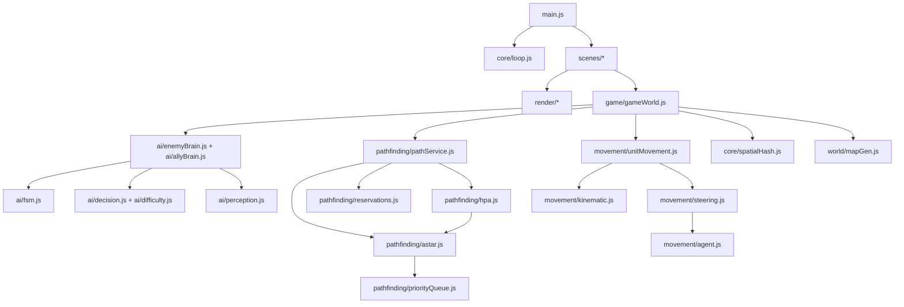
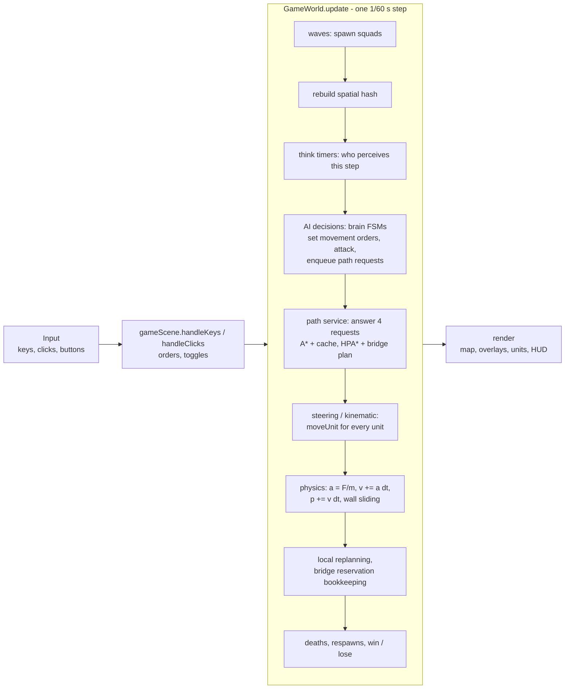

# Architecture

## Folder structure

```
siege-of-the-grid/
├── index.html              canvas + HTML panels (menu, pause, end, How It Works, AI Lab, toolbar)
├── style.css               canvas scaling (3:2) and panel styles
├── package.json            only for `npm test` (node --test), no dependencies
├── src/
│   ├── main.js             creates the shared `app` object, registers scenes, starts the loop
│   ├── config.js           every tunable number (map, steering, units, AI, waves, performance)
│   ├── core/               engine-like basics
│   │   ├── loop.js         fixed timestep (60 Hz) + requestAnimationFrame
│   │   ├── input.js        keyboard/mouse, CSS pixels -> canvas pixels
│   │   ├── sceneManager.js one active scene: enter / exit / update / render
│   │   ├── vector.js       immutable 2D vector math
│   │   ├── rng.js          seeded LCG random numbers
│   │   └── spatialHash.js  bucket grid for neighbour queries
│   ├── world/              the map
│   │   ├── tiles.js        tile types and costs
│   │   ├── grid.js         flat Uint8Array grid, walkability, pixel <-> tile
│   │   └── mapGen.js       river, 3 bridges, rocks, forests, flood-fill connectivity
│   ├── movement/           how bodies move
│   │   ├── agent.js        physics step (kinematic or steering) + wall sliding
│   │   ├── kinematic.js    velocity-setting behaviors
│   │   ├── steering.js     force behaviors + prioritized blending
│   │   ├── formations.js   Line / V / Box slot offsets
│   │   └── unitMovement.js movement ORDERS (idle, path, route, slot, arrive) -> forces or velocity
│   ├── pathfinding/        where to go
│   │   ├── priorityQueue.js binary heap
│   │   ├── astar.js        A* on the weighted 8-direction grid
│   │   ├── smoothing.js    line-of-sight smoothing, HPA* shortcut pass
│   │   ├── hpa.js          hierarchical pathfinding
│   │   ├── reservations.js bridge reservation table
│   │   ├── pathService.js  request queue, time slicing, cache, bridge planner
│   │   └── benchmark.js    A* vs HPA* comparison
│   ├── ai/                 what to do
│   │   ├── fsm.js          generic state machine
│   │   ├── enemyBrain.js   enemy states and transitions
│   │   ├── allyBrain.js    ally states and transitions
│   │   ├── decision.js     weighted random choice + predictable rules
│   │   ├── difficulty.js   Easy/Normal/Hard and AI mode -> aiSettings
│   │   ├── perception.js   sight checks
│   │   └── formationKeeping.js slot keeping with catch-up paths
│   ├── game/               the rules of this game
│   │   ├── gameWorld.js    the whole simulation, one step at a time
│   │   ├── units.js        unit factory (Agent + stats + order + brain)
│   │   ├── combat.js       reach, damage, cooldown
│   │   ├── base.js         the base rectangle and key points
│   │   ├── squads.js       leader, members, shared target
│   │   └── waves.js        10 waves of growing size
│   ├── render/             drawing only
│   │   ├── draw.js, mapRenderer.js, unitRenderer.js, overlays.js, hud.js, barChart.js
│   └── scenes/             screens
│       ├── menuScene.js, gameScene.js, howItWorksScene.js, endScene.js, aiLabScene.js
│       └── lab/            behaviorPlayground.js, pathCompare.js, benchmarkView.js
├── tests/                  node --test unit tests (pure logic only)
└── docs/                   this documentation
```

**The key rule:** everything in `core/` (except `loop.js` and `input.js`), `world/`,
`movement/`, `pathfinding/`, `ai/` and `game/` is **pure logic**. It never touches
the DOM or the canvas. That is why `node --test` can import it, and why the tests
can run a whole game headless (`new GameWorld(seed, app)` and call `update`).
Only `render/`, `scenes/`, `input.js`, `loop.js` and `main.js` use the browser.

## Modules and their dependencies



## Data flow of one frame

`core/loop.js` calls `update(1/60)` zero or more times (fixed timestep with an
accumulator), then `render()` once. Inside the game scene, one update step is:



The same order in words, with the function names:

1. **Input**: `Input` records events between steps; `gameScene.handleKeys` and
   `handleClicks` turn them into commands (`world.orderCommanderTo`,
   `cycleFormation`, `toggleGuard`, `setAiOptions`, overlay toggles). `input.endStep()`
   clears them after the step.
2. **AI decisions**: `unit.brain.update(dt)` for every ally and enemy. States read
   perception (`opponentsNear` through the spatial hash, `findVisibleEnemy`), set
   `unit.order`, attack (`tryAttackUnit`, `tryAttackBase`), and ask for paths with
   `world.requestPath` / `requestRoute`. Those calls only **queue** a request.
3. **Path service**: `paths.update(time)` answers at most 4 requests (time slicing).
   Path requests use A* with an LRU cache; route requests use HPA*, and routes
   across the river go through `planCrossingRoute` (bridge reservations). The
   answer arrives in the brain's callback, which sets the unit's order.
4. **Steering**: `moveUnit` turns the order into either a kinematic velocity or a
   list of weighted forces (avoidance, separation, evade, goal), blended by
   `combinePrioritized`. A unit holding at a bridge just brakes.
5. **Physics**: `Agent.applySteeringForce` / `applyKinematicVelocity` integrate and
   slide along walls.
6. **After movement**: `updateLocalReplanning` (stuck units replan their next 2
   waypoints), `updateBridgeCrossings` (release reservations), `handleDeaths`
   (squad leader promotion, respawn queues) and `checkEndConditions`.
7. **Render**: `gameScene.render` draws the map, the enabled overlays, the units,
   the two HUD panels and the help overlay. Rendering never changes the simulation.

## Why it is organised this way

- **Brains decide WHAT, movement decides HOW.** A brain only sets an order
  (`arriveOrder(point)`, `routeOrder(route)`, ...). The same order works in
  kinematic and steering mode, which is why K can switch every unit live.
- **Strategy objects for behaviour variations.** Difficulty and the
  predictable/uncertain switch live in `world.aiSettings`; the enemy FSM calls
  `chooseAction` without knowing which strategy is active.
- **Asynchronous path requests.** Brains never call A* directly. They queue a
  request and react in a callback, so the queue can be time-sliced and cached
  without any change to the brains.
- **One seeded RNG per game.** `GameWorld` owns the only RNG used by the
  simulation, so a seed replays the same game.
